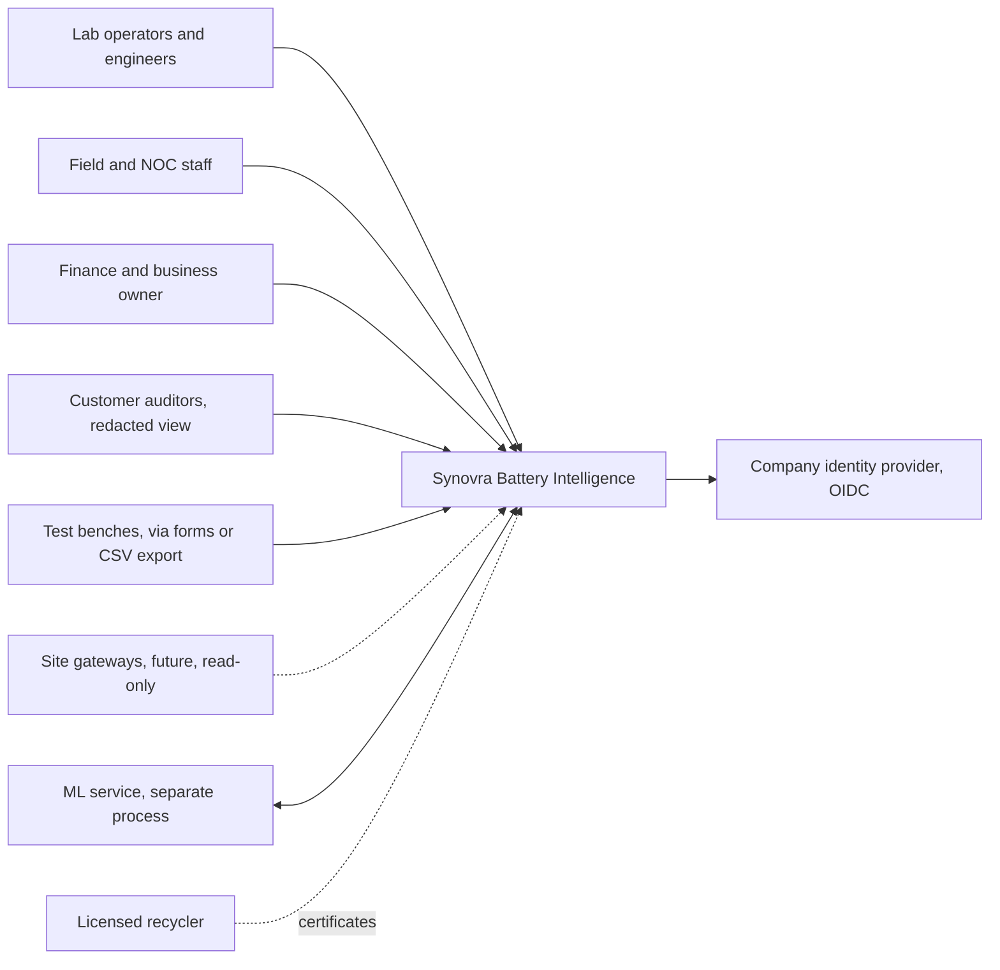
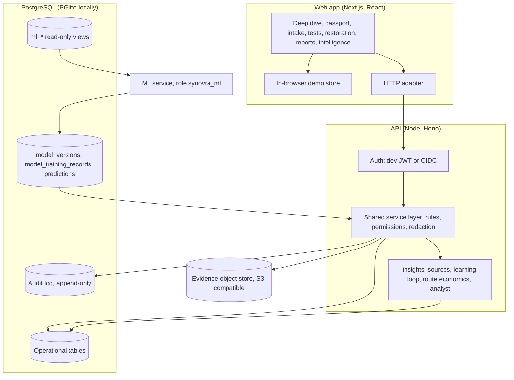
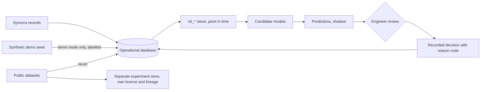
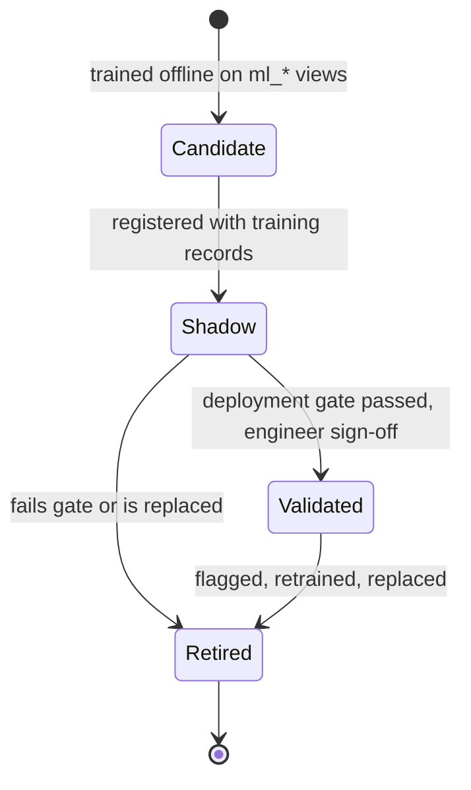

# Architecture

Written for Synovra's technical team and the engineers who would take this from prototype to pilot. It describes what is built in this repository, how it is meant to grow, and what is not yet known. Nothing here assumes Synovra's cloud provider, region, network or devices: those are listed under [Known unknowns](#known-unknowns).

## Principles

- **One deployable, clear boundaries.** A modular monolith: one web app, one API, one database. Records, ingestion, economics, insights and agents are separate modules behind typed interfaces (`src/services/types.ts`), so any of them can be split out later if load or team ownership calls for it.
- **One set of business rules.** The same service code runs in the browser demo and in the API (`src/services`), so the rules cannot drift between them. The database repeats the critical rules as constraints.
- **History is never rewritten.** Lifecycle events and the audit log are append-only. Corrections are new events that keep the previous value.
- **People decide.** Rules, models and agents produce labelled suggestions. Qualification, routing and anything that touches equipment stay with an authorised person.
- **Unknown stays unknown.** A missing value is shown as missing, never as zero or as a guess.

## Context



Dotted lines are not connected in this build.

## Components



| Module | Code | Owns |
| --- | --- | --- |
| Battery records | `src/services/mock/batteries.ts`, `tests.ts`, `restoration.ts`, `deployments.ts` | Identity, lifecycle, tests, attempts, assignments, corrections |
| Ingestion | `src/services/mock/imports.ts`, `src/domain/csv.ts` | CSV preview, validation, quarantine, idempotent commit |
| Economics | `src/domain/routeEconomics.ts`; batch economics in `restoration.ts` | Revive, test or recycle per battery; contribution per batch |
| Insights and analyst | `src/services/mock/insights.ts` | Data sources, learning loop, recovery metrics, the four capabilities, question routing |
| ML contract | `server/drizzle/0004_*.sql`, `0005_ml_views.sql`, `server/sql/ml_service_role.sql` | Training views, lineage, review flags, ML role |
| Evidence | `server/src/evidence/*` | Upload checks, checksums, malware scan, storage |

## Battery workflow

```mermaid
sequenceDiagram
  actor Lab as Lab operator
  actor Eng as Engineer
  participant P as Platform
  Lab->>P: Register battery (ID, QR, family, source)
  Lab->>P: Record intake test (method, instrument, calibration, values)
  Eng->>P: Approve test (not the person who recorded it)
  Eng->>P: Mark restoration candidate
  P-->>Eng: Route calculator: revive, test or recycle (decision support)
  Lab->>P: Open attempt in a batch (lot references)
  Lab->>P: Record after-test, submit for review
  Eng->>P: Qualify, rework or reject, with a reason code
  P->>P: Append event; attempt becomes a training row if eligible
  Note over P: Deploy, monitor, return, warranty, recycle: each an appended event
```

## Data flow and boundaries



- **Synthetic data** exists only in demo mode and is labelled in the interface and in each record's source.
- **Public datasets** never enter the operational database (see `docs/research/datasets.md`).
- **Predictions** are written only by the ML service and shown as shadow until they pass the gate. The API can record only a person's agree or disagree.
- **Decisions** are always a person's, stored with their reason code.

## Deployment

| Stage | What runs | Data |
| --- | --- | --- |
| Demo in a browser | `npm run build && npm start`; no server | In-memory, mirrored to `localStorage` |
| Local API | `npm run server:dev` (embedded PGlite) | `./.data/pglite` |
| Full stack | `docker compose -f deploy/compose.yml up --build`: PostgreSQL 16, S3-compatible object storage, API, web and a proxy, one public address | Docker volumes |
| Pilot (to decide) | One API container, managed PostgreSQL, object storage, OIDC | Synovra's environment, once confirmed |

### The deployable stack

`deploy/compose.yml` runs the whole product behind one address (default `http://localhost:8088`). Caddy sends `/api`, `/health`, `/ready` and `/metrics` to the API and everything else to the web app, so the browser build contains no host name (`NEXT_PUBLIC_API_BASE_URL` is empty) and the same images move between environments unchanged. Evidence goes to S3-compatible storage (SeaweedFS locally, pinned by digest; any S3 service in production, set with `EVIDENCE_*`). `node deploy/smoke.mjs <address>` drives the stack through the proxy: page loads, login, create a battery and a test, upload evidence, read it back byte for byte, and confirm an anonymous request is refused. CI runs it (`.github/workflows/ci.yml`, job `stack`). It uses dev sign-in; production needs `AUTH_MODE=oidc` and a real secret store (`docs/pilot-readiness.md`).

### What was measured, and where it stops

The demo has about 50 batteries. `server/scripts/scale-seed.ts` clones them to any size (same shape and volume of tests, events, costs, evidence and aliases, with fresh ids), and `server/scripts/load-test.mjs` times the main endpoints one request at a time and eight at once. The numbers are from a laptop (Windows, Node 22) with PostgreSQL 16 in Docker and the API on the same machine, so read them as relative, not as a capacity promise. The content is cloned and synthetic: this measures volume, not realism.

Profiling found the cost was almost all in the service layer, not the database: every battery looked up its own tests, costs and aliases by scanning whole collections, and the duplicate check compared each battery with every other. Records are now grouped by battery once per request (`byBattery`, `byId`, `QualityIndex`), and reads share one frozen copy of the cached records instead of cloning them. `server/tests/scale.test.ts` checks the indexed duplicate check against the plain scan on a scaled seed with planted clashes.

Median milliseconds, one request at a time:

| Endpoint | 5,000 before | 5,000 after | 20,000 after |
| --- | --- | --- | --- |
| Register (all batteries) | 3,363 | 111 | 266 |
| Battery passport | 684 | 60 | 112 |
| Overview | 3,132 | 182 | 568 |
| Collection pipeline | 839 | 80 | 174 |
| Learning loop | 565 | 60 | 81 |
| Recovery (finance) | 2,873 | 73 | 165 |
| One write (create a battery) | 1,921 | 2,009 | 7,729 |

At 20,000 batteries the same code took 72 to 140 seconds per register request before the change (from the server log; the load test could not finish). Eight requests at once on one API process: register 354 ms at 5,000 and 1,385 ms at 20,000; overview 1,111 ms and 4,232 ms.

What still limits it, in the order it will be hit:

1. **A write costs a full reload and a full comparison.** The cache is dropped when data changes, so the next write reloads every record and compares them all to find what changed: about 2 s at 5,000 batteries and 7.7 s at 20,000. Writes are serialised. This is the first ceiling. The fix is targeted loads (only the records a service touches) and writing the changed records directly, not a bigger machine.
2. **The register is unpaginated.** It is 3.5 MB at 5,000 batteries and 14 MB at 20,000. Add server-side paging and filtering before the register is used at that size.
3. **One Node process is one CPU for the service code.** Eight simultaneous overview requests queue. Replicas help reads (the cache is keyed on the database's data version, so every replica notices a write) but have not been tested here, and they do not help writes.
4. **Not measured:** a real network between web, API and database, managed PostgreSQL, large evidence volumes, and any live telemetry (no telemetry is ingested).

A job queue for imports and reports and a time-series store belong after real telemetry arrives. GPUs are not needed for anything planned (`docs/ML_PLAN.md`).

## Pluggability: the seams

Everything that varies between sites is behind a small interface or a file, so adopting it is configuration or one new adapter. Nothing below needs a change to the screens, the services or the database.

| Seam | Interface | Built in | Plug in your own | Test |
| --- | --- | --- | --- | --- |
| Evidence storage | `BlobStore` (put, get, check) | Local disk; S3-compatible (`aws4fetch`) | Any object store: implement `BlobStore` | `server/tests/evidence.test.ts` |
| Malware scan | `Scanner` (scan, check) | None (logged warning); ClamAV daemon (`EVIDENCE_SCAN=clamd`) | Any scanner implementing `Scanner` | `evidence.test.ts` |
| Identity | Verified `Principal` | Dev sign-in; OIDC (JWKS, issuer, audience) | Any OIDC provider; roles map to users by email | `server/tests/oidc.test.ts` |
| Database | `DATABASE_URL` | Embedded PGlite; PostgreSQL 16 | Any PostgreSQL 16 | CI job `api-postgres` |
| Language model | `LlmProvider` (`status`, `chat`) in `src/services/agent/provider.ts` | Ollama (local, default); OpenAI-compatible (`LLM_PROVIDER=openai`, `LLM_BASE_URL`, `LLM_API_KEY`, `LLM_MODEL`) | Anything that answers chat with tool calls | `tests/unit/provider.test.ts` (fake server, real loop) |
| Bench result files | `BenchProfile`: delimiter, decimal mark, date order, header names, declared constants and unit scale (`src/domain/benchProfile.ts`) | Synovra standard; one example layout | A JSON array in the file named by `BENCH_PROFILES_FILE`, validated at start-up | `tests/unit/benchProfile.test.ts` |
| Device readings | `RegisterMap` and `decodeRegisters` (`src/domain/registerMap.ts`): address, type, word order, scale, plausible range, no-reading values | One example map, marked as an illustration | A map written from the device's own documentation | `tests/unit/registerMap.test.ts` |
| Error alerts | Slack-compatible webhook | `ERROR_WEBHOOK_URL` | Any endpoint accepting `{ text }` | `operations.test.ts` |
| Reverse proxy | Caddy routes by path | `deploy/Caddyfile` | Any proxy with the same four routes | CI job `stack` |

Three rules keep these safe to plug into:

- **A profile or map never repairs data.** A bench cell the profile cannot read is passed on unreadable and the row is quarantined; a decimal comma file containing a "." is refused as ambiguous; an impossible date is not rolled over; a device value outside its plausible range is dropped and reported, never clamped. A profile is declared by a person, and the preview lists what it changed.
- **A model provider changes where the words come from, not what the agent can do.** The tool list, the read-only rule, the allowlist and the check that every number came from a tool are in the loop, not the provider. With `LLM_PROVIDER=openai` the conversation, which includes record contents returned by tools, is sent to `LLM_BASE_URL`; choose that endpoint like any other place customer data goes.
- **Device decoding is separate from device access.** `decodeRegisters` takes words that something already read and opens no connection. The site gateway that speaks the device protocol, and the ingestion endpoint that would receive its observations, are not built (V2). There is no real manufacturer map in this repository and none has been checked against hardware.

## ML operations



- **Training data:** only from `ml_restoration_attempt_features` and later views. Features come from records that existed when the attempt started. The app's learning loop and the database view count the same rows, and a test checks that they do.
- **Lineage:** `model_training_records` names every record a version used. A correction to one of those batteries flags the version for review (`ml_model_review_flags`).
- **Gate:** grouped and time-based splits, per-family results, calibration, a baseline rule to beat, and written sign-off. The database refuses `validated` without an evaluation report.
- **Removing a record's influence:** retrain without it, register the new version, retire the old one. No trained model is edited in place.
- **Monitoring:** review flags for corrections and unseen families, protocols or instruments; agree and disagree rates on shadow outputs.

## Agent operations

- **One entry point, four capabilities.** A fixed router (`route()` in `insights.ts`) sends a question to data quality, battery evidence, recovery decision or process learning. A question it cannot place gets a plain "can't answer" and examples.
- **Tool allowlist.** Capabilities call named, read-only tools: `validate_records`, `get_battery_history`, `compare_process_cohorts`, `calculate_route_economics`, `get_model_prediction` (reports "unavailable" while no validated model exists), `retrieve_approved_procedure` (reports "none on file") and `get_cost_lines` (permission-checked). There is no free-form SQL, no write, and no device access.
- **Visible working.** Every answer lists the tools called, the records cited and what was missing. When the records cannot support an answer, it says so.
- **Audit.** Each question is logged (`analyst.ask`) with the capability it went to.
- **Tests as evaluation.** The example questions are fixed test cases (`tests/unit/analyst.test.ts`). Before a language model is ever added, those cases become its evaluation set, plus refusal cases: equipment control, other tenants, invented numbers.
- **Local model agent (development).** `src/services/agent` runs a tool loop on a model served by Ollama on the same machine. The model chooses which of eight read-only tools to call and in what order (up to six steps), then summarises. Tools run through the same services, so with the caller's permissions. A tool outside the allowlist is refused. Every number in the answer is checked against the tool results and any that are not found are shown to the reader. In the browser demo it calls `localhost:11434`; through the API, the loop runs outside any database transaction and each tool call is its own short read, so a slow model never holds the database. Runs are audited (`agent.run`). Nothing leaves the machine.
- **What the first live runs showed.** A 9B model on CPU took about two minutes per goal. It chained tools on its own, but it misread an ambiguous tool result ("45/49" read as missing rather than recorded). The fix was in the tool output (name both "recorded" and "missing"), not the prompt. The grounding check alone would not have caught it, because the numbers were real; that is why tool results are always shown under the answer and a person decides.
- **Model choice.** The provider and model are settings (`LLM_PROVIDER`, then `OLLAMA_MODEL` or `LLM_MODEL`; see Pluggability). Prefer a standard instruction-tuned model with tool support (for example `qwen2.5:7b`) for anything shown outside development.

## Threat model (short)

| Threat | Control in this build | Still needed for a pilot |
| --- | --- | --- |
| Someone approves their own test | Service rule and a database check | — |
| A role sees costs or process data it should not | Service-layer permissions; customer redaction; costs hidden from analyst tools | Permission review with Synovra |
| History is altered to change an outcome | Append-only triggers on events and audit | Database role separation for operators |
| A model or agent acts on its own | ML role is insert-only; agents are read-only; no device writes exist | Keep it that way when adding an LLM |
| A malicious upload | Size and type checks, checksum, malware scan hook | A real scanner in the pilot environment |
| Device network exposure | No device connection exists | Segmented network, read-only gateway, no inbound access |
| Prompt injection through record text | No LLM; text from records is never executed | Treat record text as data in any future LLM prompt |

**Backup and recovery:** not set up. Before real records are the only copy, add scheduled PostgreSQL backups, object-store versioning, a tested restore drill and a migration rollback plan (also listed in `server/README.md`).

## Decisions

| Decision | Why | Revisit when |
| --- | --- | --- |
| Modular monolith, not microservices | One small team; a pilot measured in thousands of batteries | Teams or load need independent deploys |
| Shared service layer in browser and API | One copy of the business rules | The API needs SQL-level performance for hot reads |
| PostgreSQL, with PGlite locally | Constraints, views and roles; runs with no Docker | — |
| Rules and arithmetic before models | Too few labelled outcomes; transparent baselines are needed anyway | Enough labelled attempts per family |
| Deterministic analyst router as the fallback; local model through Ollama for the agent | Testable, no data leaves the machine, numbers checked against tools | A hosted provider is approved, with an evaluation set |
| No device integration | No register map or authorised access | Synovra supplies documentation and permission |

## Known unknowns

To confirm with Synovra's technical team:

- Cloud provider, region, data-residency rules and tenancy.
- Identity provider and how staff accounts are managed.
- Existing systems that hold battery, sales or recycling records, and their export formats.
- Test benches in use, what they measure (capacity, resistance, conductance, impedance) and their export formats.
- The communication box: model, authorised access, and the register map. Until these exist it stays unconnected (see Intelligence → Connections).
- The real pass criteria, reason codes and process versions, all placeholders here.
- Retention policy for records, evidence and audit history.
