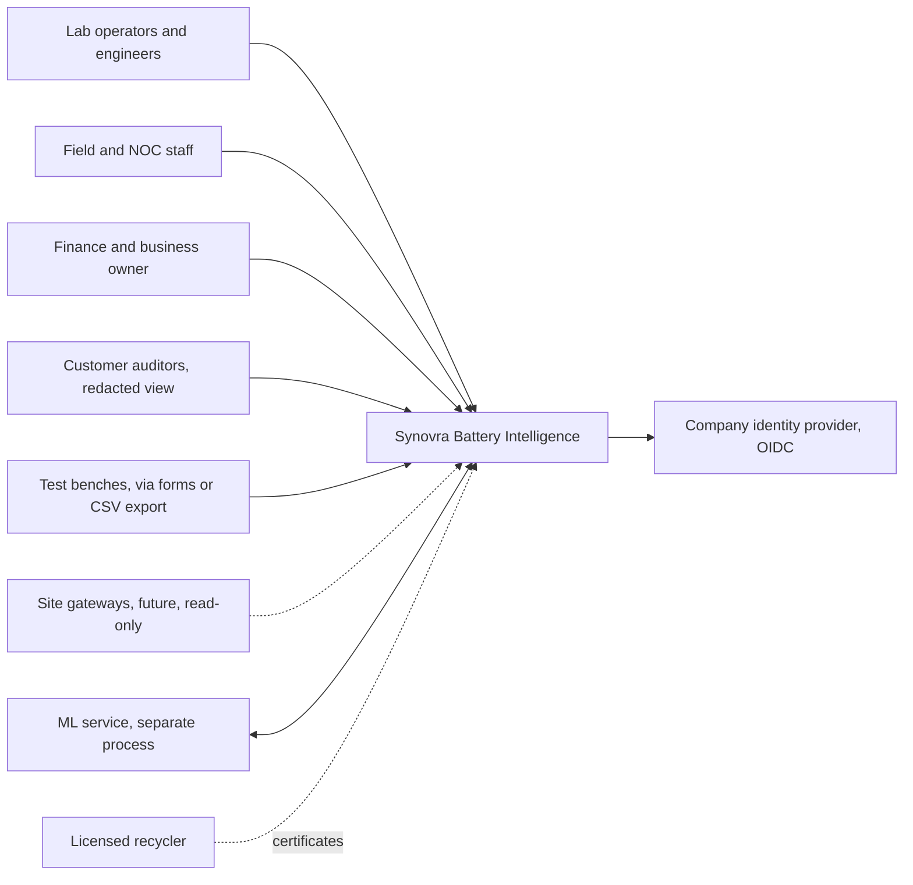
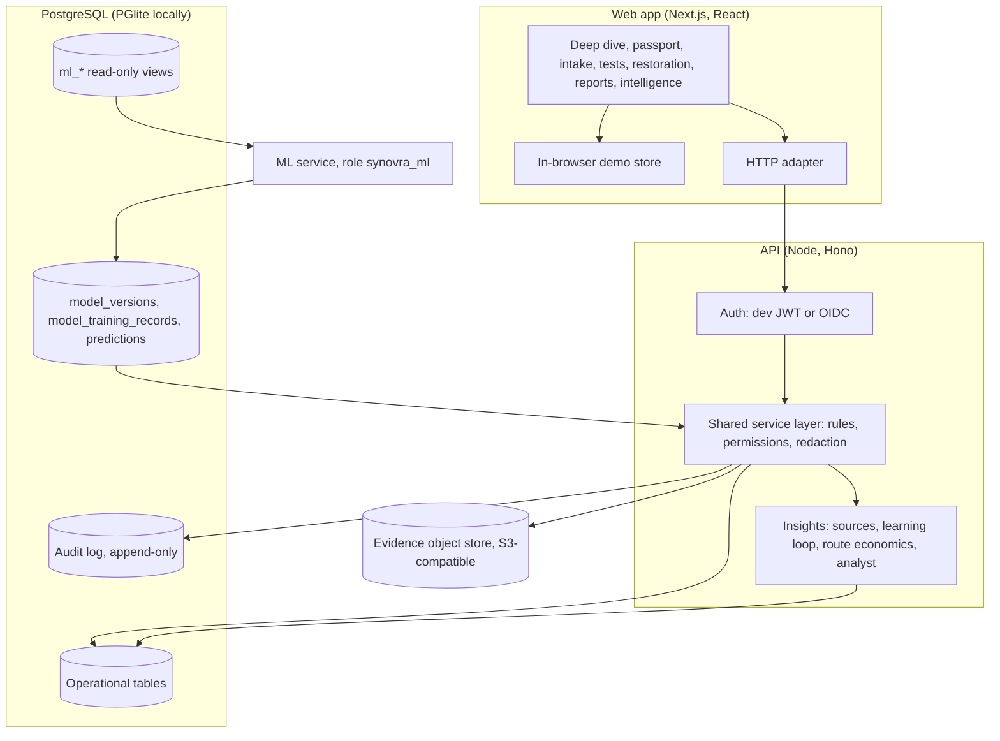
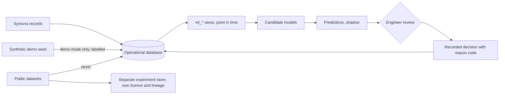
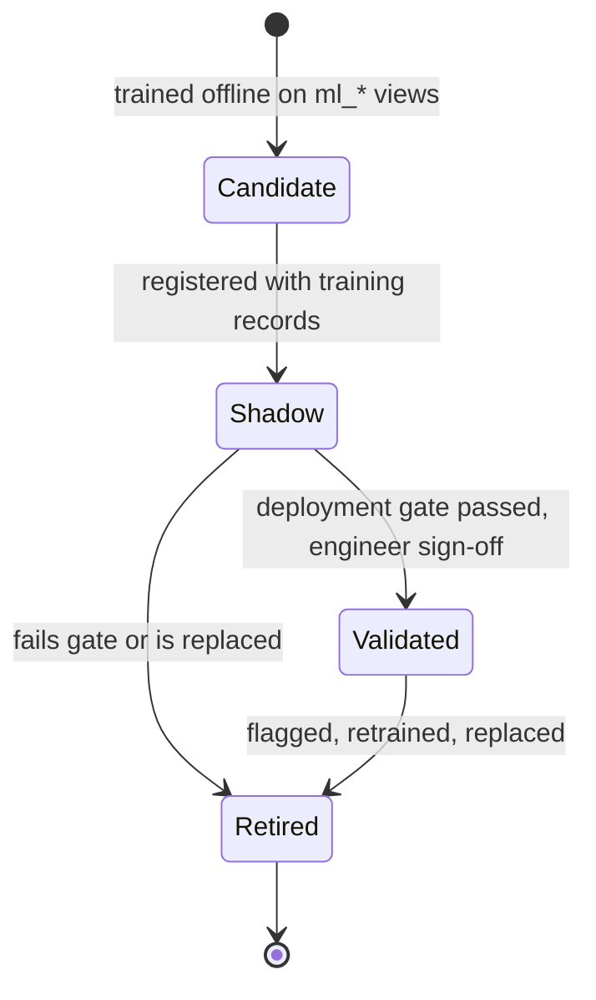

# Architecture

Written for Synovra's technical team and the engineers who would take this from prototype to pilot. It describes what is built in this repository, how it is meant to grow, and what is not yet known. Nothing here assumes Synovra's cloud provider, region, network or devices: those are listed under [Known unknowns](#known-unknowns).

## Principles

- **One deployable, clear boundaries.** A modular monolith: one web app, one API, one database. Records, ingestion, economics, insights and agents are separate modules behind typed interfaces (`src/services/types.ts`), so any of them can be split out later if load or team ownership calls for it.
- **One set of business rules.** The same service code runs in the browser demo and in the API (`src/services`), so the rules cannot drift between them. The database repeats the critical rules as constraints.
- **History is never rewritten.** Lifecycle events and the audit log are append-only. Corrections are new events that keep the previous value.
- **People decide.** Rules, models and agents produce labelled suggestions. Qualification, routing and anything that touches equipment stay with an authorised person.
- **Unknown stays unknown.** A missing value is shown as missing, never as zero or as a guess.

## Context



Dotted lines are not connected in this build.

## Components



| Module | Code | Owns |
| --- | --- | --- |
| Battery records | `src/services/mock/batteries.ts`, `tests.ts`, `restoration.ts`, `deployments.ts` | Identity, lifecycle, tests, attempts, assignments, corrections |
| Ingestion | `src/services/mock/imports.ts`, `src/domain/csv.ts` | CSV preview, validation, quarantine, idempotent commit |
| Economics | `src/domain/routeEconomics.ts`; batch economics in `restoration.ts` | Revive, test or recycle per battery; contribution per batch |
| Insights and analyst | `src/services/mock/insights.ts` | Data sources, learning loop, recovery metrics, the four capabilities, question routing |
| ML contract | `server/drizzle/0004_*.sql`, `0005_ml_views.sql`, `server/sql/ml_service_role.sql` | Training views, lineage, review flags, ML role |
| Evidence | `server/src/evidence/*` | Upload checks, checksums, malware scan, storage |

## Battery workflow

```mermaid
sequenceDiagram
  actor Lab as Lab operator
  actor Eng as Engineer
  participant P as Platform
  Lab->>P: Register battery (ID, QR, family, source)
  Lab->>P: Record intake test (method, instrument, calibration, values)
  Eng->>P: Approve test (not the person who recorded it)
  Eng->>P: Mark restoration candidate
  P-->>Eng: Route calculator: revive, test or recycle (decision support)
  Lab->>P: Open attempt in a batch (lot references)
  Lab->>P: Record after-test, submit for review
  Eng->>P: Qualify, rework or reject, with a reason code
  P->>P: Append event; attempt becomes a training row if eligible
  Note over P: Deploy, monitor, return, warranty, recycle: each an appended event
```

## Data flow and boundaries



- **Synthetic data** exists only in demo mode and is labelled in the interface and in each record's source.
- **Public datasets** never enter the operational database (see `docs/research/datasets.md`).
- **Predictions** are written only by the ML service and shown as shadow until they pass the gate. The API can record only a person's agree or disagree.
- **Decisions** are always a person's, stored with their reason code.

## Deployment

| Stage | What runs | Data |
| --- | --- | --- |
| Demo in a browser | `npm run build && npm start`; no server | In-memory, mirrored to `localStorage` |
| Local API | `npm run server:dev` (embedded PGlite) | `./.data/pglite` |
| Local stack | `docker compose up --build`: PostgreSQL 16 and the API image | Docker volume |
| Pilot (to decide) | One API container, managed PostgreSQL, object storage, OIDC | Synovra's environment, once confirmed |

Scale-up only when measured: dedicated SQL for hot reads (the API loads all records per request today, fine for thousands of batteries), a job queue for imports and reports, and a time-series store only when real telemetry arrives. GPUs are not needed for anything planned (`docs/ML_PLAN.md`).

## ML operations



- **Training data:** only from `ml_restoration_attempt_features` and later views. Features come from records that existed when the attempt started. The app's learning loop and the database view count the same rows, and a test checks that they do.
- **Lineage:** `model_training_records` names every record a version used. A correction to one of those batteries flags the version for review (`ml_model_review_flags`).
- **Gate:** grouped and time-based splits, per-family results, calibration, a baseline rule to beat, and written sign-off. The database refuses `validated` without an evaluation report.
- **Removing a record's influence:** retrain without it, register the new version, retire the old one. No trained model is edited in place.
- **Monitoring:** review flags for corrections and unseen families, protocols or instruments; agree and disagree rates on shadow outputs.

## Agent operations

- **One entry point, four capabilities.** A fixed router (`route()` in `insights.ts`) sends a question to data quality, battery evidence, recovery decision or process learning. A question it cannot place gets a plain "can't answer" and examples.
- **Tool allowlist.** Capabilities call named, read-only tools: `validate_records`, `get_battery_history`, `compare_process_cohorts`, `calculate_route_economics`, `get_model_prediction` (reports "unavailable" while no validated model exists), `retrieve_approved_procedure` (reports "none on file") and `get_cost_lines` (permission-checked). There is no free-form SQL, no write, and no device access.
- **Visible working.** Every answer lists the tools called, the records cited and what was missing. When the records cannot support an answer, it says so.
- **Audit.** Each question is logged (`analyst.ask`) with the capability it went to.
- **Tests as evaluation.** The example questions are fixed test cases (`tests/unit/analyst.test.ts`). Before a language model is ever added, those cases become its evaluation set, plus refusal cases: equipment control, other tenants, invented numbers.
- **If a language model is added:** run it server-side with the caller's permissions, let it choose only from the allowlist, keep the deterministic router as the fallback, and never let it produce a number that did not come from a tool.

## Threat model (short)

| Threat | Control in this build | Still needed for a pilot |
| --- | --- | --- |
| Someone approves their own test | Service rule and a database check | — |
| A role sees costs or process data it should not | Service-layer permissions; customer redaction; costs hidden from analyst tools | Permission review with Synovra |
| History is altered to change an outcome | Append-only triggers on events and audit | Database role separation for operators |
| A model or agent acts on its own | ML role is insert-only; agents are read-only; no device writes exist | Keep it that way when adding an LLM |
| A malicious upload | Size and type checks, checksum, malware scan hook | A real scanner in the pilot environment |
| Device network exposure | No device connection exists | Segmented network, read-only gateway, no inbound access |
| Prompt injection through record text | No LLM; text from records is never executed | Treat record text as data in any future LLM prompt |

**Backup and recovery:** not set up. Before real records are the only copy, add scheduled PostgreSQL backups, object-store versioning, a tested restore drill and a migration rollback plan (also listed in `server/README.md`).

## Decisions

| Decision | Why | Revisit when |
| --- | --- | --- |
| Modular monolith, not microservices | One small team; a pilot measured in thousands of batteries | Teams or load need independent deploys |
| Shared service layer in browser and API | One copy of the business rules | The API needs SQL-level performance for hot reads |
| PostgreSQL, with PGlite locally | Constraints, views and roles; runs with no Docker | — |
| Rules and arithmetic before models | Too few labelled outcomes; transparent baselines are needed anyway | Enough labelled attempts per family |
| Deterministic analyst router, no LLM yet | Testable, no data leaves the system, no invented numbers | Evaluation cases are agreed and a provider is approved |
| No device integration | No register map or authorised access | Synovra supplies documentation and permission |

## Known unknowns

To confirm with Synovra's technical team:

- Cloud provider, region, data-residency rules and tenancy.
- Identity provider and how staff accounts are managed.
- Existing systems that hold battery, sales or recycling records, and their export formats.
- Test benches in use, what they measure (capacity, resistance, conductance, impedance) and their export formats.
- The communication box: model, authorised access, and the register map. Until these exist it stays unconnected (see Intelligence → Connections).
- The real pass criteria, reason codes and process versions, all placeholders here.
- Retention policy for records, evidence and audit history.
